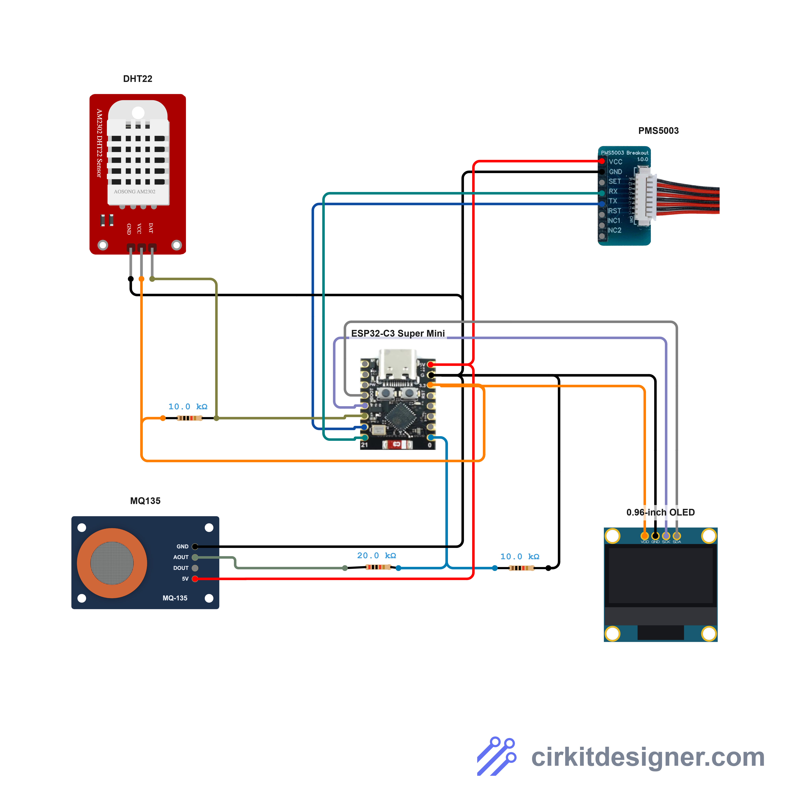

# Air Quality Edge AI

An ESP32-C3-based environmental monitoring system that streams raw sensor data
and (eventually) runs an on-device ML classifier to detect air quality states:

| State    | Meaning                                   |
|----------|-------------------------------------------|
| `GOOD`     | Clean air (e.g. window open)              |
| `MODERATE` | Stale / indoor air (e.g. window closed)   |
| `POOR`     | Smoke / elevated pollutants (e.g. candle) |

## Hardware

| Component | Interface | ESP32-C3 pin | Notes                                   |
|-----------|-----------|--------------|-----------------------------------------|
| PMS5003   | UART      | RX `GPIO20`, TX `GPIO21` | 9600 baud, 32-byte frames |
| MQ-135    | Analog ADC| `GPIO0` (ADC1_CH0)       | Use a voltage divider (5V -> <=3.3V) |
| DHT22     | Digital   | `GPIO10`                 | Temp / humidity |
| OLED SSD1306 | I2C    | SDA `GPIO8`, SCL `GPIO9` | 128x64, addr `0x3C`, **3.3 V only** |
| Status LEDs | GPIO    | `GPIO4/5/6`              | GOOD / MODERATE / POOR (Phase 6) |



Board: **ESP32-C3-DevKitM-1** (RISC-V, native USB-CDC).

## Repository layout

```
firmware/            PlatformIO project (C++)
  include/config.h   Pins, sampling params, CSV schema
  src/main.cpp                 Dev firmware: sensors + OLED + WiFi/weather + LEDs
  src/raw_data_collection.cpp  Collect firmware: sensors -> 16-col CSV only (no OLED/WiFi)
  src/sensor_test.cpp          Bring-up harness (DHT22 + OLED + MQ-135 + PMS5003)
  src/sensors.cpp    MQ-135 + DHT22 drivers
  src/pms5003.cpp    PMS5003 UART parser (non-blocking state machine)
  src/display.cpp    SSD1306 OLED rendering + interim AQ status heuristic
  src/net.cpp        WiFi + SNTP (Stuttgart) + OpenWeatherMap (dev firmware only)
  src/i2c_scan.cpp   Boot-time I2C bus scanner (diagnostic)
  include/secrets.example.h  Template for WiFi creds + OWM key (copy to secrets.h)
  partitions.csv     Custom partition table (~3 MB app slot for ML headroom)
  models/            Exported model headers (.gitkeep placeholder)

> Only one `setup()`/`loop()` may be active at a time. To switch firmware,
> rename the unwanted main to `*.cpp.disabled` (PlatformIO ignores it) and the
> desired one to `*.cpp`. `.disabled` files are tracked in git.

logger/              Host-side serial -> CSV recorder
  session_logger.py  Named-session recorder (e.g. "good1" -> data/raw/good/good_1_<ts>.csv)
  logger.py          Older menu-based recorder (scene label -> data/raw/<scene>/)
  _bootcapture.py    Reset board + capture boot/serial output (diagnostic)

data/
  raw/{good,moderate,poor}/   Recorded CSVs per scene (contents git-ignored)
  processed/                  Preprocessed feature windows (git-ignored)

ml/                  Training / preprocessing / export pipeline
  notebooks/         Exploration

docs/                Design notes
.github/workflows/   CI (placeholder)
```

## Data schema (16 raw columns)

```
timestamp_ms,
pm1_cf1,pm25_cf1,pm10_cf1,
pm1_atm,pm25_atm,pm10_atm,
n03,n05,n10,n25,n50,n100,
mq135_raw,temp_c,hum_pct
```

> **Note:** The PMS5003 used is a clone whose *mass* fields stay zero; the
> *particle count* fields (`n03`..`n100`) carry the real signal. All values are
> recorded raw - the ML stage decides which features to use. DHT read failures
> are written as `-999.0`.

## OLED display

A 0.96" SSD1306 (128x64, I2C at `0x3C`) shows live readings. The module is a
**dual-color** panel: the top 16 px band is yellow, the rest is blue.

The connected weather-station layout (`display_update_env()`, used by the dev
firmware):

```
[yellow]  Temp:23.1C Hum:57%
[blue]    Room Air: GOOD
[blue]    Mon 14 Apr 10:42
[blue]    City: Stuttgart
[blue]    Out: 5C, Cloudy
```

Status is abbreviated to keep the line uniform: `GOOD` / `MOD` / `POOR`.
An interim rule-based status drives the display and the status LEDs until the
ML classifier (Phase 6) is deployed. If no OLED is attached, the firmware logs
`# OLED init failed` and continues logging normally.

## Network & weather (dev firmware)

The dev firmware (`src/main.cpp`) connects to WiFi and shows a connected
weather-station screen on the OLED (the `display_update_env()` layout above).

- **WiFi** — 2.4 GHz only (ESP32-C3 has no 5 GHz radio), non-blocking. The
  sampling/CSV loop runs regardless of connection state.
- **Time** — SNTP with the `Europe/Berlin` TZ (`CET-1CEST,M3.5.0,M10.5.0/3`),
  auto DST. Stuttgart local time.
- **Weather** — OpenWeatherMap "current weather" for `Stuttgart,DE` (metric),
  fetched every 15 min over HTTPS.
- **Fail-safe** — if WiFi or the API is unavailable, the affected lines show
  `--` (e.g. `-- -- --- --:--`, `--C --`). CSV logging is never affected.

**Setup:** copy the secrets template and fill in your values (git-ignored):

```powershell
cd firmware
copy include\secrets.example.h include\secrets.h
# edit include\secrets.h: WIFI_SSID, WIFI_PASSWORD, OWM_API_KEY
```

The data-collection firmware (`raw_data_collection.cpp`) does **not** include
`net.h` and stays lean (no WiFi / TLS). See the switching note in that file.

## Quick start

### Firmware

```powershell
# Build & flash (PlatformIO)
cd firmware
& "$env:USERPROFILE\.platformio\penv\Scripts\pio.exe" run -t upload
& "$env:USERPROFILE\.platformio\penv\Scripts\pio.exe" device monitor
```

### Data logging

Flash the **data-collection firmware** first (16-column raw schema), then run
the named-session logger. Pass an optional session name; it is auto-detected
along with the COM port, in any order.

```powershell
pip install pyserial

# Name a session -> data/raw/<class>/<name>_<timestamp>.csv
python logger/session_logger.py good1        # -> data/raw/good/good_1_<ts>.csv
python logger/session_logger.py moderate1    # -> data/raw/moderate/moderate_1_<ts>.csv
python logger/session_logger.py poor1        # -> data/raw/poor/poor_1_<ts>.csv

# No argument: prompts for the name, auto-detects the port
python logger/session_logger.py

# Explicit port (same result; order-independent)
python logger/session_logger.py COM3 good1
```

- The **first word must be a class** (`good` / `moderate` / `poor`) — it chooses
  the training folder. The rest is a free label, so you can record many
  sessions per class: `good1`, `good2`, `good3`, `moderate1`, ...
- `good1` / `good 1` / `good-1` / `Good1` all resolve to `good` + `good_1`.
- Press **Ctrl+C** to stop. The header is written immediately and rows are
  flushed as they arrive, so even a short run leaves a valid CSV.
- `#`-prefixed diagnostic lines are skipped; malformed rows are skipped and
  reported (never silently dropped). Fragment-tolerant line reassembly.

> The logger expects the **16-column** schema from `raw_data_collection`. The
> development/bring-up firmware streams different columns and is not meant for
> recording.

## Roadmap

- [x] Sensor bring-up (MQ-135, DHT22, PMS5003) & 16-column raw CSV stream
- [x] OLED (SSD1306) live display + status LEDs
- [x] All-sensor bring-up verification (per-sensor + combined test firmware)
- [x] Named-session logger (`good1`, `moderate1`, ... -> per-class folders)
- [x] Multi-hour logger with per-scene folder labelling
- [ ] Record GOOD / MODERATE / POOR datasets
- [ ] Preprocessing + feature engineering (`ml/`)
- [ ] Train 3-class classifier
- [ ] Export model to ESP32 (TFLite / C array) and drive status LEDs

## License

See [LICENSE](LICENSE).
